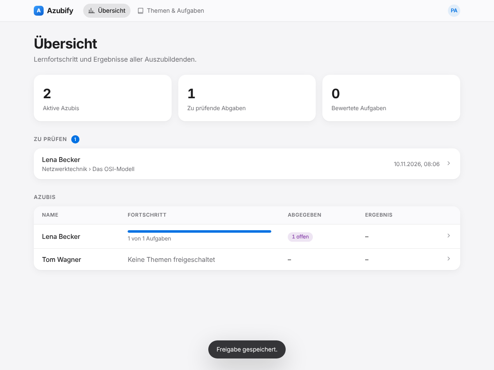
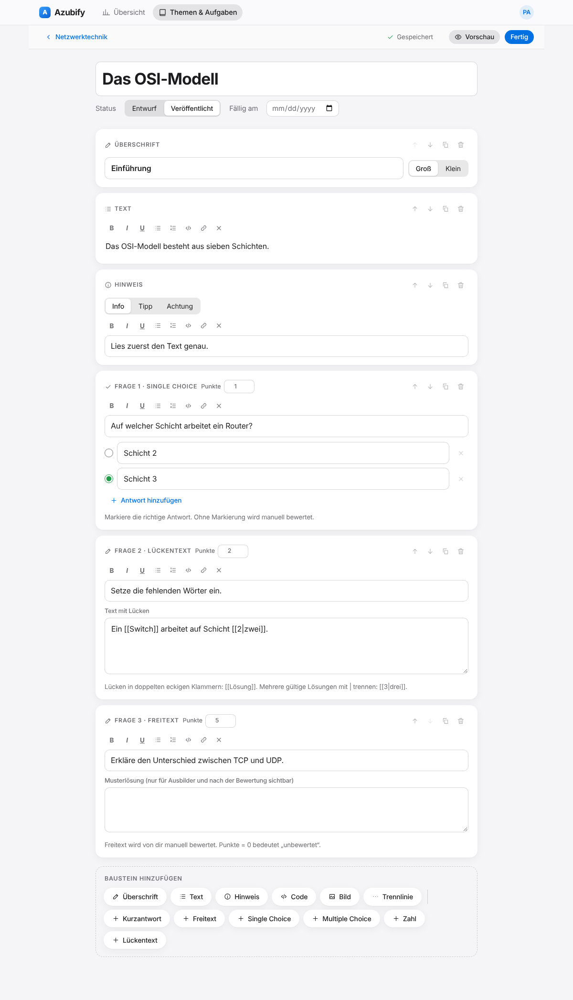
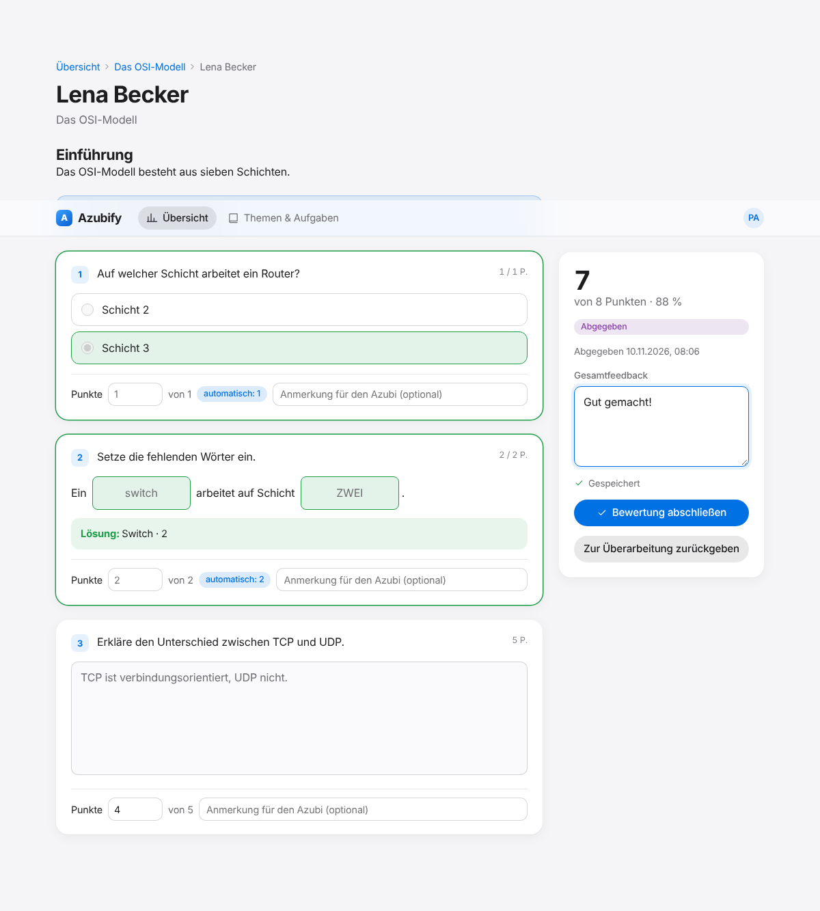
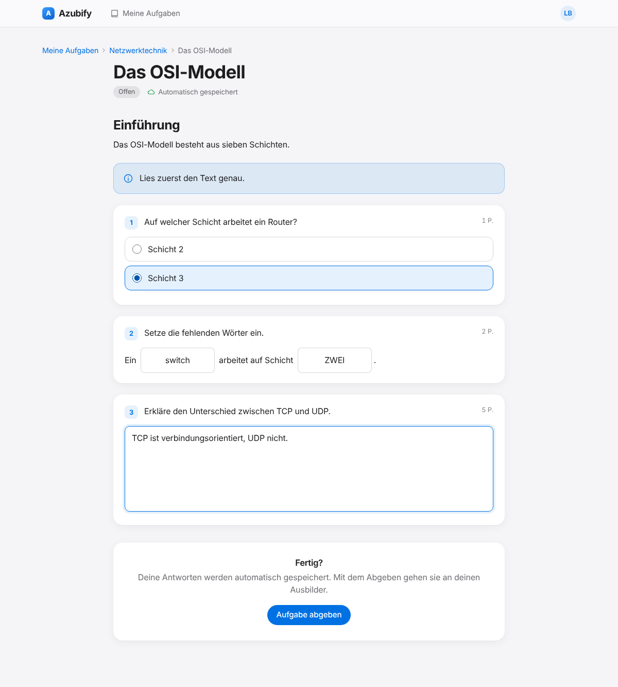

<div align="center">

# Azubify

**Aufgabenplattform für die Ausbildung.**
Ausbilder erstellen Aufgaben wie in der Schule, Azubis lösen sie direkt im Browser – jede Eingabe wird automatisch gespeichert.

[](https://github.com/flowoy96/Azubify/actions/workflows/docker.yml)



</div>

## Features

**Aufgaben erstellen**
- Block-Editor (WYSIWYG): Überschriften, formatierter Text, Hinweis-Boxen, Code, Bilder, Trennlinien
- Fragetypen: Kurzantwort, Freitext, Single Choice, Multiple Choice, Zahl (mit Toleranz und Einheit), Lückentext
- Aufgaben in Themengebiete gruppieren, als Entwurf speichern oder veröffentlichen, Fälligkeitsdatum setzen, duplizieren
- Themen gezielt für einzelne Azubis oder alle auf einmal freischalten

**Lösen & Bewerten**
- Automatisches Speichern bei jeder Eingabe, mit zusätzlicher lokaler Sicherung im Browser (Absturz, Verbindungsabbruch und Neuladen verlieren nichts)
- Automatische Auswertung, wo eine Lösung hinterlegt ist; Freitext wird manuell bewertet (Punkte und Anmerkung je Frage, Gesamtfeedback)
- Ablauf: Bearbeiten → Abgegeben → Bewertet – oder zur Überarbeitung zurückgeben
- Lösungen und Musterlösungen sieht der Azubi erst nach der Bewertung (sie werden vorher nicht einmal an den Browser geschickt)

**Überblick**
- Ausbilder sehen Lernfortschritt und Ergebnisse aller Azubis sowie eine Liste der noch zu prüfenden Abgaben
- Hell-/Dunkelmodus automatisch, für Smartphone und Desktop

### Rollen

| Rolle | Rechte |
|---|---|
| **Admin** | alles, plus Benutzerverwaltung (Azubis und Ausbilder anlegen, Passwort zurücksetzen, deaktivieren, löschen) |
| **Ausbilder** | Themen und Aufgaben erstellen, Azubis freischalten, Abgaben prüfen, Fortschritt aller Azubis sehen |
| **Azubi** | freigeschaltete Aufgaben bearbeiten und abgeben, eigene Ergebnisse einsehen |

## Screenshots

| Editor | Bewertung | Azubi-Ansicht |
|---|---|---|
|  |  |  |

## Installation mit Docker / Portainer

Das fertige Image wird bei jedem Push auf `main` von GitHub Actions gebaut und liegt unter
`ghcr.io/flowoy96/azubify:latest` (amd64 und arm64). Es muss nichts selbst gebaut werden.

### Portainer

1. **Stacks → Add stack → Web editor**
2. Folgenden Inhalt einfügen, `ADMIN_PASSWORD` ändern und **Deploy the stack** klicken:

```yaml
services:
  azubify:
    image: ghcr.io/flowoy96/azubify:latest
    container_name: azubify
    restart: unless-stopped
    ports:
      - "3000:3000"
    environment:
      ADMIN_USER: admin
      ADMIN_PASSWORD: "BITTE-AENDERN-12345"
      # COOKIE_SECURE: "true"   # wenn hinter einem HTTPS-Reverse-Proxy
    volumes:
      - azubify-data:/data

volumes:
  azubify-data:
```

3. `http://<server>:3000` öffnen und mit `ADMIN_USER` / `ADMIN_PASSWORD` anmelden.
4. Unter **Benutzer** Azubi- und Ausbilder-Accounts anlegen. Neue Benutzer müssen beim ersten Login ihr Passwort ändern.

### Docker Compose

```bash
curl -O https://raw.githubusercontent.com/flowoy96/Azubify/main/docker-compose.yml
docker compose up -d
```

### Konfiguration

| Variable | Bedeutung | Standard |
|---|---|---|
| `ADMIN_USER` | Benutzername des Admins (wird nur beim allerersten Start angelegt) | `admin` |
| `ADMIN_PASSWORD` | Passwort des Admins (nur beim ersten Start). Ohne Angabe wird ein Einmal-Passwort im Container-Log ausgegeben | – |
| `COOKIE_SECURE` | `true` erzwingt Secure-Cookies (bei HTTPS hinter Proxy meist automatisch erkannt) | auto |
| `PORT` | Port im Container | `3000` |
| `DATA_DIR` | Speicherort für Datenbank und Bilder | `/data` |

### Betrieb

- **Daten:** SQLite-Datenbank und hochgeladene Bilder liegen im Volume `/data`. Dieses Volume regelmäßig sichern.
- **HTTPS:** Für den Zugriff aus dem Internet einen Reverse Proxy (Traefik, Nginx Proxy Manager, Caddy …) vorschalten.
- **Update:** In Portainer den Stack mit „Pull and redeploy“ aktualisieren bzw. `docker compose pull && docker compose up -d`.

## Entwicklung

Voraussetzung: Node.js ≥ 22.13 (nutzt das eingebaute `node:sqlite`, keine nativen Abhängigkeiten).

```bash
npm install
ADMIN_PASSWORD=Admin12345 npm run dev   # http://localhost:3000
npm test
```

Aufbau: `server/` (Express-API, SQLite, Bewertungslogik), `public/` (Frontend ohne Build-Schritt, Vanilla-JS-Module), `Dockerfile`, `.github/workflows/docker.yml`.

Lokales Image bauen: `docker build -t azubify .`
